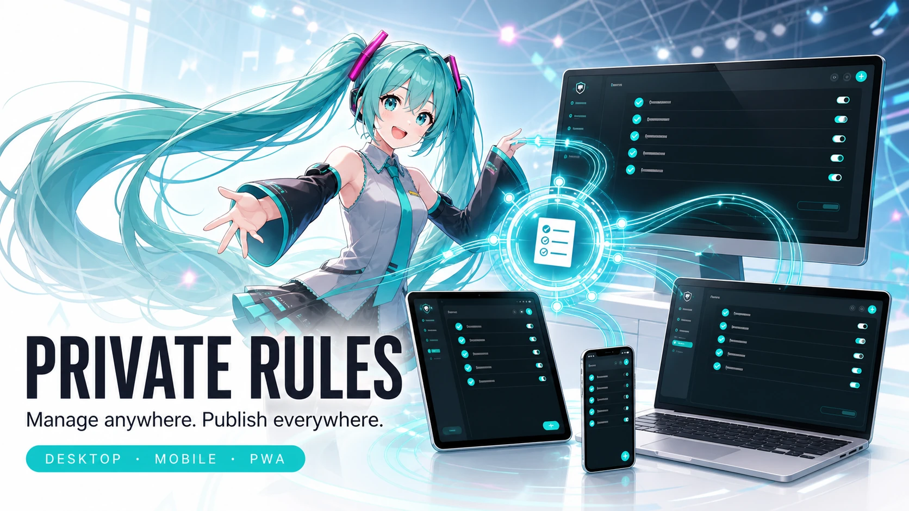

<div align="center">

# Private Rules

**操作简单、维护方便，随时随地管理自己的分流规则与客户端配置订阅。**



[](https://hub.docker.com/r/cyclince/private-rules/tags)
[](https://hub.docker.com/r/cyclince/private-rules/tags)
[](./LICENSE)

[功能概览](#你会得到什么) · [快速开始](#快速开始) · [部署方式](#部署方式对照) · [订阅格式](#订阅格式) · [1.1.0 升级指南](./docs/upgrade-1.1.0.md) · [更新说明](./docs/1.1.0.md) · [本地开发](#本地开发)

</div>

---

## 这是什么

Private Rules 是一个私有、自托管的规则与配置控制台，支持 **Cloudflare Workers** 和 **Docker Compose** 两种部署方式。

它包含两个彼此独立的模块，按需要选用即可：

- **分流规则**（1.0.x 已有能力）：汇总自定义域名 / IP、远程订阅、GeoSite、GeoIP 与社区规则，自动定时同步和去重，生成通用规则订阅链接（YAML、LIST、TXT、JSON）。
- **配置模板**（1.1.0 公测新增）：通过 3 步向导选好代理软件、勾选常用分流场景、填入机场节点订阅，直接生成可导入 mihomo、Stash、Surge、sing-box、Loon、Quantumult X、Shadowrocket 的完整配置；也可以把自己的分流规则加进去。

所有规则、模板、登录会话与访问策略都保存在你自己的 Cloudflare D1 或 SQLite 数据库中。节点订阅地址在本地用 AES-256-GCM 加密保存，不经过任何第三方在线转换服务。

## 为什么需要它

公开规则很方便，但真正顺手的配置往往分散在好几个地方：社区规则源、GeoSite / GeoIP、自己临时加的域名和内网 IP，还有换客户端时反复折腾的配置文件。

Private Rules 把这两件事都收拢到一个顺手的后台里：

- **只想维护规则？** 直接用「分流规则」模块，和 1.0.x 一样简单：建规则、自动同步、去「订阅」页复制链接。
- **想要可直接导入的完整配置？** 打开「配置模板」，跟着 3 步向导点选场景、贴上机场订阅，就能同时生成多个客户端的订阅链接和二维码。

上游规则持续更新，而最终分流、访问权限、节点地址和运行环境始终握在你自己手里。

## 你会得到什么

### 分流规则（与 1.0.x 一致）

| 能力 | 实际结果 |
| --- | --- |
| 四种起点建规则 | 支持从零构建、上游订阅、GeoSite / GeoIP 数据库和社区规则，首次创建自动同步 |
| 白话识别与提示 | 添加域名、IP 或 IP 段时自动识别类型，用白话说明生效范围，附带规则类型速查 |
| 自动同步与去重 | 按来源独立维护与定时更新，不覆盖手工规则，支持去重与按行为拆分输出 |
| 独立订阅中心 | 每条规则单独控制公开、私密 Token 或停用，按软件折叠展示链接、引用示例与二维码 |

### 配置模板（1.1.0 公测新增）

| 能力 | 实际结果 |
| --- | --- |
| 3 步生成配置 | 选软件 → 选常用分流场景与自己的规则 → 填节点订阅并预览地区分布，两分钟搞定 |
| 多客户端支持 | 一份模板同时输出 mihomo、Stash、Surge、sing-box、Loon、Quantumult X、Shadowrocket |
| 场景库与导入 | 内置常用分流场景，支持复制修改，也支持导入现有 ACL4SSR `.ini` 或 mihomo YAML |
| 节点隐私保护 | 节点订阅地址本地 AES-256-GCM 加密且只写不读，含节点的输出强制走私密 Token |

### 通用体验与运维

| 能力 | 实际结果 |
| --- | --- |
| 多端响应式后台 | Miku 青色主题，浅色 / 深色 / 跟随系统；适配电脑、平板和手机，支持 PWA 与 Telegram Mini App |
| 双运行时部署 | Cloudflare Workers + D1 或 Docker Compose + SQLite，同一套代码与数据库自动升级 |
| 备份与缓存 | 支持 JSON 备份与恢复（兼容 1.0.x 备份）、ETag / 304 缓存、健康检查与 Telegram 通知 |

## 规则如何完成一次旅程

### 1. 分流规则：构建并获取规则订阅

在「规则」页新建一条规则，可以选择自己手写，或者接入上游订阅、GeoSite / GeoIP 和社区规则。后台会记住每个上游来源，定时同步并去重，同时保护你手工维护的内容不被覆盖。

同步完成后，前往「订阅」页选择这条规则的访问策略（私密 / 公开 / 停用），再展开对应的代理软件复制链接或扫码即可。同一条规则不用自己维护多份文件，格式转换由服务端自动完成。

### 2. 配置模板：3 步生成完整配置

需要直接可用的客户端配置时，打开「模板 → 新建模板」：

1. **选客户端**：勾选你正在用的代理软件（可以多选）。
2. **选分流场景**：勾选想单独分流的场景（如国内直连、拦截广告、AI、流媒体等），也可以把「分流规则」里自己维护的规则直接加进来并排在最前。
3. **填节点订阅**：粘贴机场订阅地址（可提前预览识别到的节点数与地区），生成配置链接与二维码。

之后在模板详情的 **分流 / 节点 / 输出** 三个标签页里，可以随时增删场景、更换节点订阅或增加新客户端。

```text
[分流规则]
手工规则 / 上游订阅 / Geo 数据库 / 社区规则
                  ↓
        同步 · 去重 · 访问控制
                  ↓
      规则订阅链接（/rules, /sub）
                  │
                  │（可选：把我的规则加入模板）
                  ▼
[配置模板]
   选择客户端 + 勾选分流场景 + 节点订阅
                  ↓
      配置订阅链接与二维码（/p, /t）
                  ↓
mihomo · Stash · Surge · sing-box · Loon · Quantumult X · Shadowrocket
```

### 高级能力（可选）

如果你熟悉代理配置，希望做更细致的调整，可以在模板详情右上角打开 **高级编辑**（默认关闭）：

- 使用可视化画布拖拽调整应用组件与分层顺序，管理多节点槽位与节点筛选器；
- 运行 12 项实时规则检查与域名/IP 命中测试，一键开启 5 个增强模块（如防 DNS 泄漏、局域网直连等）；
- 切换输出档位（`full` / `minimal`），查看编译结果、修改层（Overlay）与版本历史回溯；
- 为 Loon / Quantumult X 手动开启实验性完整配置。

## 部署方式对照

| 能力 | Cloudflare Workers | Docker Compose |
| --- | --- | --- |
| 运行时 | Cloudflare Workers | Node.js |
| 数据库 | D1（首次请求自动升级） | SQLite（1.0.x 升级前自动生成 `.bak-1.0.x`） |
| 定时任务 | Cron Trigger | Node Scheduler |
| 静态资源 | Workers Assets | Node Static |
| 持久化 | Cloudflare 托管 | Docker Volume |
| 适用场景 | 低维护、边缘部署 | VPS、NAS、家庭服务器 |

两种方式功能一致。想省心免维护，选 Cloudflare；想把程序和数据完全留在自己机器上，选 Docker Compose。

## 快速开始

仓库默认 `docker-compose.yml` 锁定当前稳定版 `cyclince/private-rules:1.0.7`（`:latest` 也指向 `1.0.7`）。

如需体验 `1.1.0` 公开测试版，只需把 `docker-compose.yml` 里的镜像标签改为 `cyclince/private-rules:1.1.0-beta.2`（或 `cyclince/private-rules:beta`），其余配置都不用改。

```bash
mkdir -p private-rules && cd private-rules
curl -fsSLO https://raw.githubusercontent.com/Cyclince/Private_rules/main/docker-compose.yml
curl -fsSL https://raw.githubusercontent.com/Cyclince/Private_rules/main/.env.example -o .env
```

编辑 `.env`（推荐用 `openssl rand -hex 32` 生成 `RULE_TOKEN`）：

```dotenv
ADMIN_PASSWORD=请设置独立的高强度后台密码
RULE_TOKEN=请设置随机且不可猜测的订阅令牌
BASE_URL=https://rules.example.com
```

启动并检查状态：

```bash
docker compose pull
docker compose up -d
docker compose ps
```

容器显示 `healthy` 后，打开 `http://服务器地址:5173/admin/login`。

> [!IMPORTANT]
> - `RULE_TOKEN` 用于隐藏私密订阅路径，请勿公开或提交到 Git。
> - `SESSION_SECRET` 无需手动填写：首次启动会自动生成并保存在数据库中，备份数据时请连同数据目录一起备份。如需自行指定，见下方「可选环境变量」。

## 部署到 Cloudflare

### 1. Fork 并导入仓库

Fork 本仓库，在 Cloudflare Dashboard 打开 **Workers & Pages → Create application → Import a repository**，选择你的 Fork。

| Cloudflare 构建设置 | 值 |
| --- | --- |
| Production branch | `main`（体验 `1.1.0` 公测可使用 `release/1.1.0`） |
| Build command | `pnpm build` |
| Deploy command | `pnpm deploy` |
| Root directory | 留空 |

`wrangler.toml` 已声明静态资源、定时同步任务和名为 `DB` 的 D1 数据库（`migrations_dir = "src/data/migrations"`）。首次访问或定时触发时会自动完成数据库建表与升级；也可以手动执行 `pnpm db:migrate:remote`。

Cron Trigger 每 5 分钟检查一次到期任务；实际同步频率仍按你在后台设定的 15 分钟至每天执行。

### 2. 配置变量与密钥

在 **Settings → Variables and Secrets** 中添加：

| 变量或 Secret | 用途 | 必需 |
| --- | --- | --- |
| `ADMIN_PASSWORD` | 登录管理后台 | 是 |
| `RULE_TOKEN` | 生成私密订阅地址（`/sub/:token/...` 与 `/t/:token/...`） | 使用私密订阅或绑定节点时必需 |
| `BASE_URL` | 站点公网 HTTPS 地址（用于生成链接与 Telegram） | 自定义域名或 Telegram 时必需 |
| `SESSION_SECRET` | 会话签名与节点订阅加密密钥（留空自动生成并持久化；自定义时建议 ≥ 32 位） | 否 |
| `TELEGRAM_BOT_TOKEN` | BotFather 提供的 Bot Token | 否 |
| `TELEGRAM_USER_ID` | 允许使用 Bot 的数字用户 ID | 启用 Telegram 时必需 |
| `TELEGRAM_WEBHOOK_SECRET` | Telegram Webhook 校验密钥（留空自动生成并持久化） | 否 |

部署完成后访问：

```text
https://<your-worker-domain>/admin/login
```

如使用自定义域名，请在 **Domains & Routes** 绑定域名，并在环境变量或后台「设置」中填好相同的站点地址。

### 3. 可选启用 Telegram

通过 BotFather 创建 Bot，填好 `BASE_URL`、`TELEGRAM_BOT_TOKEN` 与 `TELEGRAM_USER_ID`。系统会在启动或首次请求时自动注册命令、Webhook 和 Mini App。

Bot 只响应指定用户的私聊，发送 `/start` 即可开始使用。为保证安全，Telegram Mini App 不能操作备份、API Key 和基础站点设置。

## 部署到 Docker

完整步骤请参考 [Docker Compose 从零部署](./docs/wiki/Docker-Compose-Deployment.md)。

### 可选环境变量

仓库默认的 `docker-compose.yml` 只包含常用项（与 1.0.7 一致）。下列选项都有合理默认值，平时不用写进 `docker-compose.yml`，有需要时再按需添加：

| 环境变量 | 默认值 | 说明 |
| --- | --- | --- |
| `SESSION_SECRET` | 留空时自动生成并持久化 | 会话签名与节点订阅加密密钥；自定义时生产环境需 ≥ 32 位。修改后需要重新登录，已保存的节点订阅需重新填写 |
| `LOG_LEVEL` | `info` | 日志级别：`debug` / `info` / `warn` / `error` |
| `SCHEDULER_ENABLED` | `true` | Node / Docker 是否启用内置定时同步与会话清理 |
| `SCHEDULER_INTERVAL_SECONDS` | `60` | 定时任务轮询间隔（秒，范围 `1`–`86400`） |
| `TELEGRAM_WEBHOOK_SECRET` | 留空时自动生成并持久化 | 自定义 Telegram Webhook 校验密钥 |
| `DATABASE_PATH` | `/app/data/private-rules.db` | SQLite 数据库文件路径 |
| `HOST` / `PORT` | `0.0.0.0` / `5173` | 监听地址与端口 |
| `TRUST_PROXY` | `true`（Compose）/ `false`（直接运行） | 位于可信反向代理后设为 `true`，用于识别真实客户端 IP |

### 数据保存与升级

SQLite 数据保存在 `private-rules-data` 数据卷中，重建或升级容器不会丢失数据。从 1.0.x 升级到 1.1.0 时，程序会先自动生成 `/app/data/private-rules.db.bak-1.0.x` 备份再执行升级。升级前仍建议先在后台「设置」导出一次 JSON 备份。

```bash
docker compose pull
docker compose up -d
docker compose ps
docker compose logs --tail=100 private-rules
```

除非确定要永久清空所有数据，否则不要执行 `docker compose down -v`。

### 反向代理

生产环境建议通过 Caddy 或 Nginx 提供公网 HTTPS，不要把 `5173` 端口直接暴露到公网。Caddy 示例：

```caddyfile
rules.example.com {
    reverse_proxy 127.0.0.1:5173
}
```

## 后台功能入口

- **概览**（`/admin`）：同时查看分流规则与配置模板的状态，一键同步上游。
- **分流规则 → 规则**（`/admin/rules`）：创建和维护自定义规则、上游订阅、Geo 数据库与社区规则。
- **分流规则 → 订阅**（`/admin/subscriptions`）：按规则调整访问权限，复制不同软件的规则链接或扫码。
- **配置模板 → 模板**（`/admin/templates`）：通过 3 步向导新建模板（`/admin/templates/new`）、在详情页管理分流/节点/输出，或打开场景库（`/admin/templates/scenes`）。
- **设置**（`/admin/settings`）：调整外观与语言、站点地址、图标包、API Key、备份恢复与版本信息。

## 安装为 PWA

访问 `https://<你的域名>/pwa-install` 可打开移动端安装引导（无需先登录）：

- Android 浏览器满足条件时可直接唤起系统安装；
- iPhone / iPad 会给出 Safari「分享 → 添加到主屏幕」的步骤；
- Service Worker 仅缓存页面静态外壳，不缓存 `/api`、`/rules`、`/sub`、`/p`、`/t` 和 `/health`。

## 订阅格式

### 1. 分流规则订阅（与 1.0.x 完全兼容）

公开地址为 `/rules/<文件名>`，私密地址为 `/sub/<RULE_TOKEN>/<文件名>`：

| 后缀 | 适用软件与说明 |
| --- | --- |
| `_Classical.yaml` | Mihomo 经典规则格式，输出完整 `TYPE,value` |
| `_Domain.yaml` | Mihomo 域名规则格式，输出域名与 `+.` 后缀 |
| `_IPCIDR.yaml` | Mihomo IP / 端口规则格式，自动补充不解析 DNS 选项 |
| `.yaml` | 原有 YAML 地址，按经典规则格式兼容 |
| `.list` / `-loon.list` / `-qx.list` | 通用 / Loon / Quantumult X 规则列表（Loon 与 QX 自动省略按程序名匹配的规则） |
| `.json` / `-sing-box.json` | sing-box 规则源格式 |
| `.txt` | 纯值列表，便于脚本处理 |

以 `Custom_Direct` 为例：

```text
/rules/Custom_Direct_Classical.yaml
/rules/Custom_Direct_Domain.yaml
/rules/Custom_Direct_IPCIDR.yaml
/sub/<RULE_TOKEN>/Custom_Direct.list
/sub/<RULE_TOKEN>/Custom_Direct.json
```

### 2. 配置模板订阅（1.1.0 公测新增）

公开地址为 `/p/<slug>/<文件名>`，私密地址为 `/t/<RULE_TOKEN>/<slug>/<文件名>`（填入节点订阅的输出仅允许私密 `/t/...` 访问）。在真机完成核实前，界面提供复制链接与二维码，暂不显示一键导入按钮。

| 文件名 | 目标客户端 | 说明 |
| --- | --- | --- |
| `mihomo.yaml` | mihomo / Clash Meta | 远程引用节点订阅，自动按地区分组并支持引用规则集 |
| `stash.yaml` | Stash | 适配 Stash 语法与图标 |
| `surge.conf` | Surge | 远程引用节点列表，支持地区筛选与规则集 |
| `singbox.json` | sing-box（1.12+） | 服务端解析 6 种主流协议并加密缓存 30 分钟，拉取失败自动沿用上次结果 |
| `loon.conf` | Loon | 默认只输出规则资源，不覆盖已有节点；完整配置为实验选项 |
| `qx.conf` | Quantumult X | 默认只输出规则资源（`filter_remote`）；完整配置为实验选项 |
| `shadowrocket.conf` | Shadowrocket | 输出配置且不覆盖客户端里已有的节点 |

## 数据源与同步

- **远程订阅**：支持多个 YAML、LIST 或纯文本地址，内置内网防护、15 秒超时与 20MB 大小上限。
- **GeoSite**：来自 [`v2fly/domain-list-community`](https://github.com/v2fly/domain-list-community)。
- **GeoIP**：来自 [`Loyalsoldier/geoip`](https://github.com/Loyalsoldier/geoip) release 分支。
- **图标包**：内置 [`Koolson/Qure`](https://github.com/Koolson/Qure)，支持自定义 JSON 图标包。
- **自动同步**：支持 15 分钟至每天的更新间隔，随时可以手动同步。

## 安全说明

- **登录与请求保护**：后台使用签名 `HttpOnly` Cookie，写操作校验同源请求；同一来源 15 分钟内连续输错 10 次密码将锁定 15 分钟。
- **接口隔离**：`/api/*` 仅允许同源访问；只有订阅路径（`/rules/*`、`/sub/*`、`/p/*`、`/t/*`）开放跨域读取。
- **节点隐私加密**：节点订阅地址经 AES-256-GCM 加密保存，后台只显示脱敏内容，不进日志、不进 URL 参数、不进 JSON 备份；绑定节点后禁止设为公开访问。
- **Telegram 权限隔离**：Bot 只接受指定用户私聊；Mini App 禁止访问备份、API Key 与基础站点设置。
- **妥善保管凭据**：不要把 `.dev.vars`、`.env`、密码、Token 或数据库文件提交到仓库。

## 更新与备份

- **从 1.0.x 升级**：请先查看 [1.0.x → 1.1.0 升级指南](./docs/upgrade-1.1.0.md)（Docker 只需改镜像标签并会自动生成 `.bak-1.0.x` 备份；Cloudflare D1 升级前请先执行 `wrangler d1 export`）。
- **版本变更记录**：详见 [1.1.0 更新说明](./docs/1.1.0.md)。
- 访问 `/health` 返回的 `version` 字段可确认当前运行版本。

## 本地开发

需要 Node.js 22 与 pnpm 10；只有调试 Workers 运行时或部署到 Cloudflare 时才需要 Cloudflare 账号。

```bash
pnpm install
cp .dev.vars.example .dev.vars
pnpm db:migrate:local
pnpm dev
```

打开 `http://localhost:5173/admin/login`。`.dev.vars` 已被 Git 忽略，请在其中填写本地密码。

常用检查命令：

```bash
pnpm lint
pnpm format:check
pnpm typecheck
pnpm test
pnpm test:e2e
pnpm build
pnpm size
```

## 技术栈

- Cloudflare Workers、Hono、Drizzle ORM 与 D1
- Node.js、Docker Compose 与 SQLite（`better-sqlite3`）
- React 19、TypeScript、Tailwind CSS、TanStack Router / Query 与 Vite
- Cloudflare Cron Triggers 与 Node Scheduler
- Telegram Bot、Webhook 与 Mini App
- Qure Color 与自定义 JSON 图标包

## 许可证与作者

项目基于 [MIT License](./LICENSE) 开源；第三方依赖与素材许可说明见仓库内许可声明。

- GitHub：[@Cyclince](https://github.com/Cyclince)
- Telegram：[@chong_redaily](https://t.me/chong_redaily)

> 本项目仅供学习与技术测试使用。请遵守当地法律法规，并对自己的配置、转发内容与访问行为负责。
